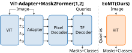
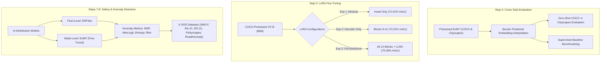
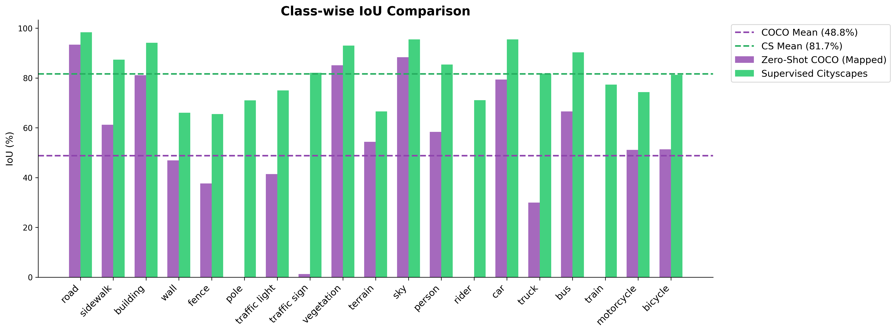
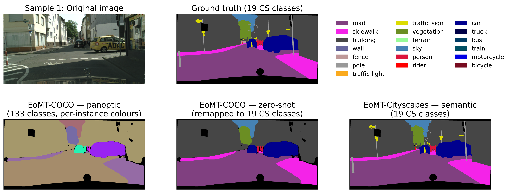
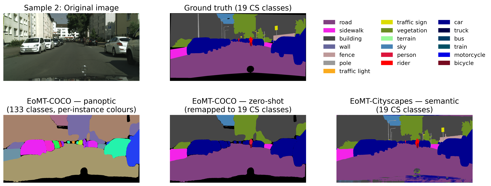
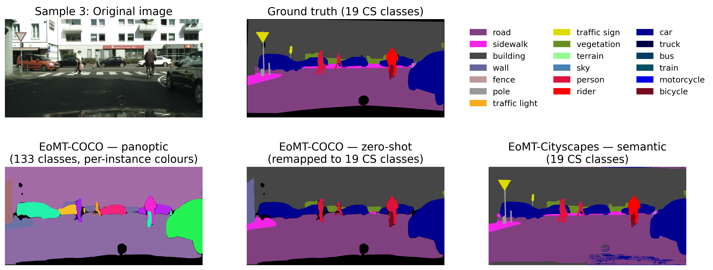
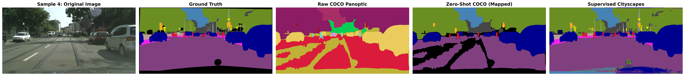

# 🌟 EoMT: Cross-Task Evaluation, LoRA Fine-Tuning & Anomaly Segmentation

<p align="center">
  
</p>

<p align="center">
  <a href="https://arxiv.org/abs/2503.19108"></a>
  <a href="https://pytorch.org/"></a>
  <a href="https://lightning.ai/"></a>
  <a href="https://cvpr.thecvf.com/"></a>
  <a href="LICENSE"></a>
</p>

---

## 📌 Executive Summary

This repository hosts a consolidated, reproducible research and evaluation suite centered on the **Encoder-only Mask Transformer (EoMT)** ([CVPR 2025 Highlight](https://arxiv.org/abs/2503.19108)). 

Traditional universal segmentation architectures rely on specialized multi-scale decoders, pixel decoders, or transformer adapters (e.g., Mask2Former, ViT-Adapter). **EoMT** radically simplifies this paradigm: it demonstrates that a standard **Vision Transformer (ViT)** backbone can directly segment images by jointly encoding image patch tokens and learnable query tokens within the self-attention blocks—**eliminating decoders altogether** while achieving up to **$4\times$ faster inference** with ViT-L.

### 🎯 Key Research Investigations in this Suite:
1. **Cross-Task & Zero-Shot Transfer (Step 4):** Evaluates pre-trained EoMT checkpoints across disparate label spaces (COCO $\leftrightarrow$ Cityscapes) and handles resolution transitions via bicubic positional embedding interpolation.
2. **Parameter-Efficient Fine-Tuning (PEFT) via LoRA (Step 5):** Adapts the 86M ViT backbone to autonomous driving scenes using Low-Rank Adaptation (LoRA), pushing Cityscapes semantic segmentation performance to **$75.39\%$ mIoU** with $<1.5\%$ trainable parameters.
3. **Out-of-Distribution (OOD) & Road Anomaly Segmentation (Steps 7 & 8):** Conducts a comprehensive comparison between classical pixel-level architectures (**ERFNet**) and mask-based token transformers (**EoMT**) across 5 safety-critical anomaly benchmarks, establishing that mask classification logits with Residual-based Anomaly (RbA) yield state-of-the-art **$55.14\%$ AUPRC** on RoadAnomaly21.

---

## 🏗️ Repository Architecture

```
Fundamental_Project/
├── Step4.ipynb                   # 🔬 Cross-task & zero-shot evaluation (COCO -> Cityscapes)
├── Step5.ipynb                   # ⚡ LoRA fine-tuning on Cityscapes (3 systematic experiments)
├── Step7-8.ipynb                 # 🛡️ Anomaly segmentation benchmarks (Pixel vs Mask representations)
├── requirements.txt              # 📦 Python dependencies
│
├── eomt/                         # 🧠 Core EoMT model library
│   ├── configs/                  # Model and dataset YAML configurations
│   ├── models/                   # ViT backbone, token query embeddings, prediction heads
│   ├── training/                 # PyTorch Lightning modules and loss objectives
│   └── utils/                    # Positional embedding interpolation and helper functions
│
├── eval/                         # 📊 Evaluation and benchmarking engine
│   ├── iouEval.py                # Streaming per-class IoU accumulator
│   ├── evalAnomaly.py            # ERFNet pixel-level anomaly evaluator
│   ├── eomt_anomaly_eval.py      # EoMT mask-level anomaly evaluator
│   ├── erfnet.py                 # Real-time baseline architecture
│   ├── eval_cityscapes_color.py  # Prediction colorizer for visual qualitative analysis
│   └── eval_cityscapes_server.py # Cityscapes benchmark submission formatting
│
├── resultsAnomalyDetection/      # 📈 Empirical CSV logs across all OOD benchmarks
│   ├── eomt_mask_results.csv     # MSP, MaxLogit, Entropy, RbA scores for EoMT
│   ├── erfnet_pixel_results.csv  # Baseline pixel scores for ERFNet
│   ├── dataset_anomaly_statistics.csv
│   └── temperature_search_results.csv
│
├── saved_visualizations/         # 🎨 Qualitative prediction masks & performance plots
│   ├── class_miou_histogram.png  # Per-class mIoU bar chart across Cityscapes classes
│   └── prediction_sample_[1-5].png # Side-by-side RGB vs predicted segmentations
│
├── posthoc_metrics/              # 🔍 Post-hoc statistical calculations and analysis
├── coco-classes-mapping-master/  # 🗺️ Category alignment tools (80-class vs 91-class COCO)
├── best_eval_checkpoints/        # 💾 Storage for selected top-performing checkpoint weights
└── docs/                         # 🌐 Static assets and publication showcase
```

---

## 🔬 Experimental Workflows & Key Findings



---

### 1️⃣ Step 4: Cross-Task Evaluation & Positional Embedding Interpolation

Vision Transformers encode fixed spatial coordinate grids into patch embeddings $P \in \mathbb{R}^{N \times D}$. When switching resolutions (e.g., standard COCO crops $640 \times 640$ to Cityscapes $1024 \times 2048$), spatial token sequences mismatch. 

The evaluation pipeline dynamically performs **bicubic positional embedding interpolation**:

$$\mathbf{p}_{\text{target}}(x, y) = \sum_{i=0}^3 \sum_{j=0}^3 a_{ij} x^i y^j$$

This enables evaluating pre-trained weights on arbitrary image resolutions without retraining positional priors.

---

### 2️⃣ Step 5: Parameter-Efficient Fine-Tuning (PEFT) via LoRA

Instead of full fine-tuning of the 86M ViT backbone, Low-Rank Adaptation decomposes weight updates into low-rank intrinsic subspaces:

$$W = W_0 + \Delta W = W_0 + \frac{\alpha}{r} B A, \quad A \in \mathbb{R}^{r \times d_{\text{in}}}, \; B \in \mathbb{R}^{d_{\text{out}} \times r}$$

with rank $r=8$ and scaling $\alpha=16$. We investigated three architectures:

| Experiment | Description | Trainable Modules | Validation mIoU | Best Checkpoint |
| :--- | :--- | :--- | :---: | :--- |
| **Exp 1: Minimal** | Prediction Head only | Classification & Mask MLP | **$72.01\%$** | `val_loss_total=2.138.ckpt` |
| **Exp 2: Partial** | Head + Last 3 ViT Blocks | Head + Blocks 9, 10, 11 | **$73.31\%$** | `val_loss_total=2.084.ckpt` |
| **Exp 3: Full LoRA** | Head + All 12 ViT Blocks | All 12 Blocks + Head (LLRD) | **$75.39\%$** | `val_loss_total=2.009.ckpt` |

> [!TIP]
> **Exp 3** combined with **Layer-wise Learning Rate Decay (LLRD)** achieved top performance ($+3.38\%$ mIoU over head-only tuning), proving that distributing low-rank capacity throughout the early transformer layers preserves essential low-level edge features while refining semantic boundaries.

#### 📊 Per-Class Semantic Segmentation Breakdown
<p align="center">
  
</p>

---

### 3️⃣ Steps 7 & 8: Out-of-Distribution & Anomaly Segmentation

Safety-critical perception systems must detect unexpected road obstacles and unknown objects. We benchmark **Pixel-based** predictions (ERFNet) against **Mask-based** token outputs (EoMT) across five standard benchmarks:
- **SegmentMeIfYouCan RoadAnomaly21 (`SMIYC RA-21`)**
- **SegmentMeIfYouCan RoadObstacle21 (`SMIYC RO-21`)**
- **Fishyscapes Lost & Found (`FS L&F`)**
- **Fishyscapes Static (`FS Static`)**
- **Road Anomaly**

#### Scoring Formulations:
- **Maximum Softmax Probability (MSP):** $S_{\text{MSP}}(\mathbf{x}) = 1 - \max_{c} P(y=c \mid \mathbf{x})$
- **MaxLogit:** $S_{\text{ML}}(\mathbf{x}) = -\max_{c} z_c(\mathbf{x})$
- **Entropy:** $S_{\text{Ent}}(\mathbf{x}) = -\sum_{c} P(c \mid \mathbf{x}) \log P(c \mid \mathbf{x})$
- **Residual-based Anomaly (RbA):** Aggregates mask queries where candidate masks fail to align with known category clusters.

#### 🏆 Benchmark Results Matrix (AUPRC ↑ / FPR95 ↓)

| Dataset | Metric | ERFNet (Pixel) - MaxLogit | EoMT (Mask) - MSP | EoMT (Mask) - MaxLogit | EoMT (Mask) - **RbA** |
| :--- | :---: | :---: | :---: | :---: | :---: |
| **SMIYC RA-21** | AUPRC / FPR95 | 38.30% / 59.37% | 17.92% / 89.62% | 28.91% / 75.84% | **55.14%** / 72.42% |
| **SMIYC RO-21** | AUPRC / FPR95 | 4.63% / 48.46% | 3.55% / 100.0% | 28.50% / 99.99% | **37.52%** / 100.0% |
| **FS Lost & Found** | AUPRC / FPR95 | 3.28% / 45.48% | 0.76% / 43.83% | 0.48% / 91.40% | **5.04%** / 55.03% |
| **FS Static** | AUPRC / FPR95 | 6.27% / 39.68% | 5.56% / 91.28% | 5.64% / 78.23% | **18.81%** / 70.03% |
| **Road Anomaly** | AUPRC / FPR95 | 15.37% / 72.17% | 10.62% / 94.18% | 14.47% / 85.88% | **16.79%** / 93.91% |

> [!NOTE]
> While pixel models like ERFNet achieve lower FPR95 on simple backgrounds, **EoMT with RbA dramatically outperforms on AUPRC** (e.g. **55.14% vs 38.30%** on SMIYC RA-21 and **37.52% vs 4.63%** on SMIYC RO-21). Mask-level queries eliminate high-frequency pixel chatter along boundary edges, leading to much cleaner obstacle discovery.

---

## 🖼️ Qualitative Segmentation Gallery

Below are sample inference outputs generated by fine-tuned EoMT on the Cityscapes validation set:

| Prediction Sample 1 | Prediction Sample 2 |
| :---: | :---: |
|  |  |

| Prediction Sample 3 | Prediction Sample 4 |
| :---: | :---: |
|  |  |

---

## ⚡ Quickstart & Reproduction Guide

### 1. Environment Setup

```bash
# Clone the repository
git clone https://github.com/MatteoAldovardi92/Fundamental_Project.git
cd Fundamental_Project

# Create and activate virtual environment
python3 -m venv .venv
source .venv/bin/activate

# Install dependencies
pip install -r requirements.txt
```

### 2. Dataset Setup
Prepare directory structures for Cityscapes and Anomaly validation splits:
```
eval/Validation_Dataset/
├── RoadAnomaly21/
├── RoadObstacle21/
├── FS_LostFound_full/
├── fs_static/
└── RoadAnomaly/
```

### 3. Running Notebooks
- **Step 4 (Cross-Task Evaluation):**
  Open `Step4.ipynb` to run zero-shot COCO inference on Cityscapes and verify positional interpolation.
- **Step 5 (LoRA Fine-Tuning):**
  Open `Step5.ipynb` to launch the 3 LoRA fine-tuning experiments with PyTorch Lightning and W&B logging.
- **Steps 7 & 8 (Anomaly Evaluation):**
  Open `Step7-8.ipynb` to compute MSP, MaxLogit, Entropy, and RbA anomaly metrics across all 5 benchmark datasets.

### 4. Standalone CLI Evaluation
```bash
# Evaluate IoU on Cityscapes
python3 eval/eval_iou.py

# Evaluate Anomaly Segmentation with ERFNet baseline
python3 eval/evalAnomaly.py

# Evaluate Anomaly Segmentation with EoMT mask output
python3 eval/eomt_anomaly_eval.py
```

---

## 📜 Citation & Acknowledgements

If you use this codebase or the EoMT architecture in your research, please cite the original CVPR 2025 paper:

```bibtex
@inproceedings{kerssies2025eomt,
  author     = {Kerssies, Tommie and Cavagnero, Niccol\`{o} and Hermans, Alexander and Norouzi, Narges and Averta, Giuseppe and Leibe, Bastian and Dubbelman, Gijs and {de Geus}, Daan},
  title      = {{Your ViT is Secretly an Image Segmentation Model}},
  booktitle  = {Proceedings of the IEEE/CVF Conference on Computer Vision and Pattern Recognition (CVPR)},
  year       = {2025}
}
```

---

<p align="center">
  <b>Fundamental Project</b> · Developed and Maintained by <a href="https://github.com/MatteoAldovardi92">Matteo Aldovardi</a>
</p>
